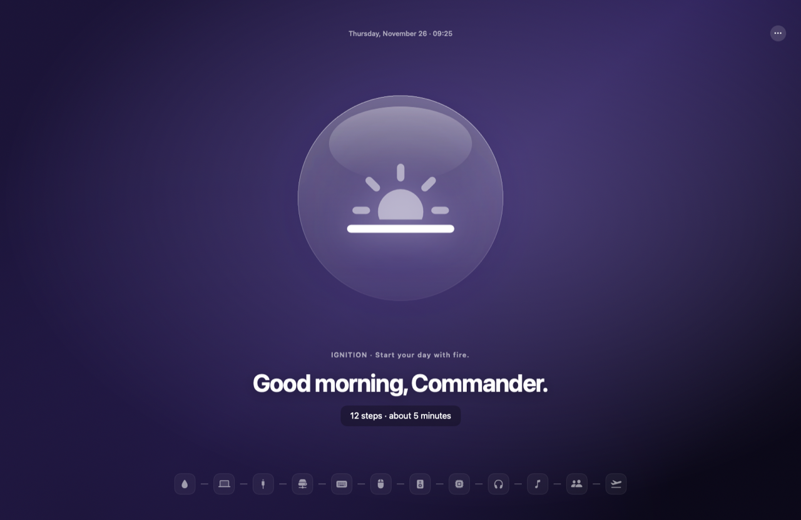
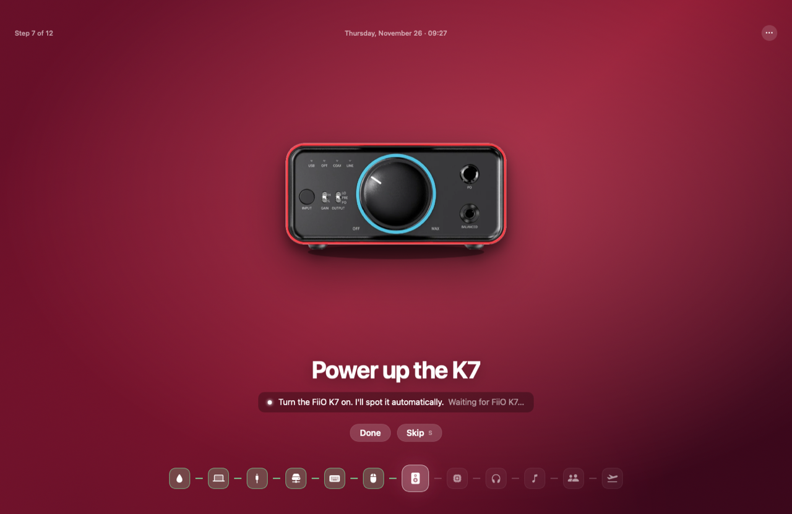
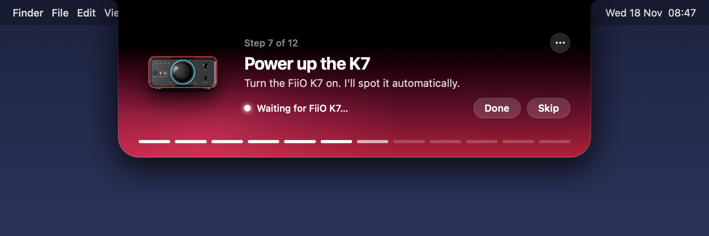
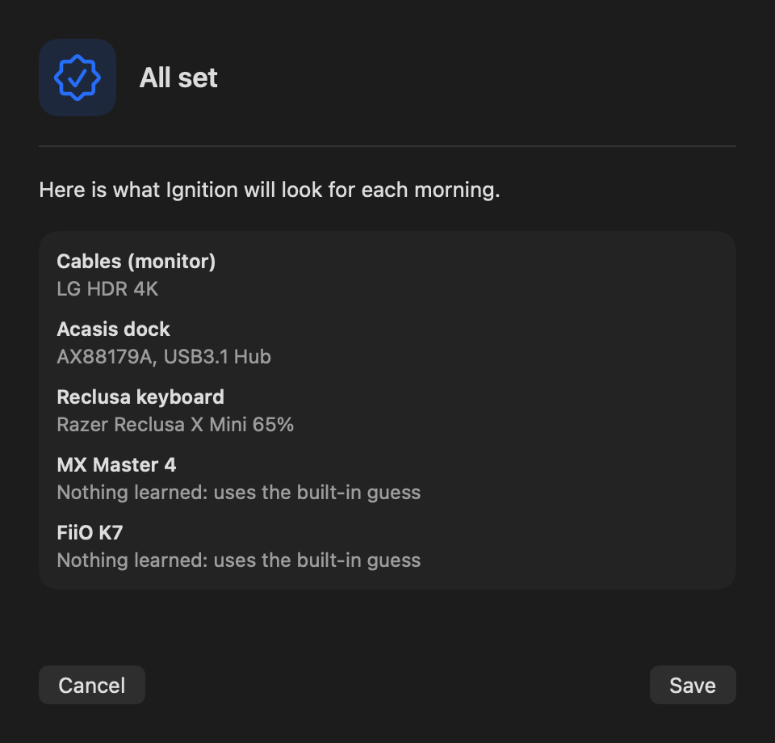

# Ignition

> **Start your day with fire.**

Ignition is a small macOS menu bar app that turns sitting down at your desk into a launch sequence.
The first time you unlock your Mac on a weekday morning, it greets you ("Good morning, Commander."),
starts some background music and walks you through a pre-flight checklist: water, laptop on the
stand, cables, dock, keyboard, mouse, DAC, the apps you work in, headphones, music. It speaks each
step, ticks off on its own whatever it can see (a USB device appearing, an audio output, a display, an
app launching or coming to the front, Apple Music starting to play) and waits for your **Done** on the
rest. It runs once a day and remembers where you left off.

The app was previously called *Liftoff*; that name lives on in the code (targets, bundle id, data
folder, the `liftoff-voices` tool) so existing settings, learned devices and voice clips keep working.

## Features

- Triggers on the first wake / unlock inside a time window on chosen weekdays; once per day, resumes an unfinished run.
- Two looks: a **notch panel** that drops out of the MacBook notch (a floating card on Macs without one) and a **fullscreen** cinematic stage.
- Auto-detection per step: USB devices, keyboards and mice (HID), audio outputs, external displays, a running app, an app brought to the front, Apple Music playing.
- "Learn my devices" wizard that records the exact devices on your desk.
- Spoken lines: pre-generated ElevenLabs clips with a "room PA speaker" effect, falling back to the best installed macOS voice. Several variants per line, never the same one two days in a row.
- Background music from your own file, ducked under the voice and handed over when Apple Music starts.
- Per-step illustrations (your own PNGs, several variants per step) or SF Symbols on a glass orb.
- Keyboard control in fullscreen: Space = Done, Return = Open <App>, S = Skip, Esc = continue in the notch panel.

## Screenshots

| | |
|---|---|
|  |  |
| Fullscreen greeting | Fullscreen step (with a user-supplied illustration) |
|  |  |
| Notch panel, expanded step | Learn my devices: summary |

The images live in [`docs/images/`](docs/images/). They are rendered by the app itself with the hidden
`--render-notch` / `--render-fullscreen` / `--render-learn` flags (see below).

## Requirements

- **macOS 14 Sonoma or later.** Apple Silicon or Intel; a notch is optional (without one the notch panel floats below the menu bar).
- **Swift 6 toolchain.** Xcode Command Line Tools are enough (`xcode-select --install`); Xcode itself is not required. The package uses swift-tools-version 6.0.
- **Apple Music** only if you keep the music step.
- **ElevenLabs account** — optional. Without it every line is read by the macOS system voice.
  On the **Free** plan, voices from the shared Voice Library cannot be used through the API: pick one
  of the *premade* voices (listed by `liftoff-voices voices`). Free also has a monthly character quota
  (about 10,000); generating the whole catalog uses roughly 6,000.
- ffmpeg is **not** needed.

## Build and run

```bash
make test      # run the test suite (147 tests)
make build     # swift build -c release
make app       # assemble + ad-hoc sign build/Ignition.app
make install   # make app, then copy to ~/Applications/Ignition.app (removes an old ~/Applications/Liftoff.app)
open ~/Applications/Ignition.app
```

**Why `make test` and not `swift test`?** The tests use Swift Testing. With only the Command Line Tools
installed, `Testing.framework` lives in `/Library/Developer/CommandLineTools/Library/Developer/Frameworks`,
which is not on the default search / rpath, so plain `swift test` fails to build or load the tests. The
Makefile adds the needed `-F` and `-rpath` flags.

`make run` (`swift run Liftoff`) starts the app unbundled from the build folder; that works for quick
checks, but launch at login and some permission prompts only behave properly for the installed `.app`.

### Command-line flags

The executable is `~/Applications/Ignition.app/Contents/MacOS/Ignition` (or `swift run Liftoff <flag>` from
the repo). Run it from Terminal to see its log lines on stderr.

| Flag | What it does |
|---|---|
| *(none)* | Normal menu bar app. |
| `--run-now` | Menu bar app that also starts a fresh pre-flight immediately, ignoring the time window and the ledger. |
| `--probe` | Prints every keyboard/mouse, then every system event (device snapshots with names and vendor/product ids, app activations, Music state, wakes) until Ctrl-C. Use it to find names for hints. |
| `--say-test` | Audio smoke test: chime, the first clip in `voices/`, a missing clip (system-voice fallback), two system-voice lines with music ducking, tick, liftoff sound. Prints the chosen system voice. |
| `--preview-notch <stepIndex>` | Shows the notch panel on screen at that step (0-based). |
| `--render-notch <stepIndex> <out.png> [variant]` | Writes PNGs of the notch panel (`<out>-expanded.png`, `-hover`, `-compact`, `-greeting`, `-liftoff`, `-nonotch`). |
| `--preview-fullscreen <stepIndex>` | Shows the fullscreen stage at that step. |
| `--render-fullscreen <stepIndex> <out.png> [variant]` | Writes `<out>-step.png`, `-hover`, `-greeting`, `-liftoff`. |
| `--render-settings <out.png>` | Renders the Settings window. |
| `--render-learn <out.png>` | Renders every page of the Learn wizard (`<out>-1-unplug.png` …). |

`[variant]` is the illustration variant number to render (see *Illustrations*).

## First-time setup

1. **Install and open** `~/Applications/Ignition.app`. An airplane icon appears in the menu bar (tooltip "Ignition — Start your day with fire."); its menu has *Start pre-flight now*, *Display mode*, *Learn my devices…*, *Settings…*.
2. **Learn my devices.** Until the cables, dock or DAC step has a learned device, the wizard opens by itself at launch. Unplug / switch off everything, click *Everything is off*, then plug in each device when asked (cables/monitor → dock → keyboard → mouse → DAC). Anything new of the right kind is recorded. *Skip* keeps the built-in guess, *Retry* ignores what appeared so far.
3. **Permissions you will see:**
   - **Automation → Music** ("Ignition wants to control Music") the first time it checks whether Apple Music is playing. Allow it, or the music step only ticks when Music *starts* playing during a run.
   - **Keychain** when the app first reads the ElevenLabs key (especially if the key was stored by the `liftoff-voices` CLI): click **Always Allow**, otherwise you are asked every morning.
4. **Settings:** display mode, time window (*Starts from* / *Until*), weekdays, voice and music toggles and volumes, room effect, ElevenLabs key and voice ID, *Regenerate voices*, *Launch at login*, and *Open assets folder*.
5. **Launch at login** — toggle it in Settings. It uses `SMAppService.mainApp`, so it only works for the installed app in `~/Applications` (the status reads "Unavailable" otherwise). If you previously enabled it for `Liftoff.app`, toggle it off and on once after installing `Ignition.app` so the login item points at the new bundle; the status line shows what macOS reports, including "Waiting for approval in System Settings › General › Login Items".
6. Try it: **Start pre-flight now** from the menu.

## Customizing it for your own setup

The default routine is the author's desk (a Reclusa keyboard, an MX Master mouse, a FiiO K7 DAC, an
Acasis dock, Agent Factory and Microsoft Teams). Here is what you can change, and how.

### The data folder

Everything lives in `~/Library/Application Support/Liftoff/` (internal name kept on purpose). *Settings › Open assets folder* opens it.

| Path | What it is | Hand-edit? |
|---|---|---|
| `config.json` | All settings, the step list, learned devices, chosen illustration variants. | Yes, with the app quit or just before a run (it is re-read on every wake / run start and when Settings opens). Invalid JSON is copied to `config.json.bak` and replaced by defaults. |
| `ledger.json` | Today's run: `inProgress(stepIndex)`, `completed` or `skipped`, with the date. | Delete it to make today's run happen again. |
| `history.json` | Which line variant was used last per step/kind (avoids repeats). | Safe to delete. |
| `voices.json` | Your editable copy of the voice lines. | Yes — see *Voice lines*. |
| `voices.bundled.json` | The pristine catalog your copy was made from; used to tell whether you edited `voices.json`. | No. |
| `voices/` | Generated clips: `<line-id>.mp3`, plus dated greetings `greeting-<yyyy-MM-dd>-<line-id>.mp3` (pruned after two days). | Safe to delete; regenerate. |
| `illustrations/` | Your step images. | Yes. |
| `music/` | Your background track. | Yes. |

### config.json

A trimmed example (keys are sorted when the app saves; any missing key falls back to its default):

```json
{
  "displayMode": "fullscreen",
  "window": { "startMinute": 480, "endMinute": 630, "weekdays": [2, 3, 4, 5, 6] },
  "voiceEnabled": true,
  "voiceVolume": 1.0,
  "voiceRoomEffect": true,
  "musicEnabled": true,
  "musicVolume": 0.6,
  "duckLevel": 0.35,
  "elevenLabsVoiceID": "21m00Tcm4TlvDq8ikWAM",
  "illustrationVariants": { "dac": 2 },
  "learned": {
    "dac": [ { "kind": "audioOutput", "name": "FiiO K7" } ],
    "cables": [ { "kind": "display", "name": "LG ULTRAFINE", "vendorID": 7789, "productID": 23741 } ]
  },
  "steps": [ "… see Steps below …" ]
}
```

| Field | Meaning |
|---|---|
| `window.startMinute` / `endMinute` | Minutes after midnight, inclusive (480 = 08:00, 630 = 10:30). |
| `window.weekdays` | Calendar numbering: **1 = Sunday, 2 = Monday … 7 = Saturday**. |
| `displayMode` | `"notch"` or `"fullscreen"`. |
| `voiceVolume`, `musicVolume` | 0…1. |
| `duckLevel` | Music level while the voice speaks, as a fraction of `musicVolume`. |
| `voiceEnabled`, `musicEnabled`, `voiceRoomEffect` | Toggles; the room effect is the "small room PA" EQ + echo on the voice. |
| `elevenLabsVoiceID` | Voice used for generation; null/absent = system voice only. |
| `learned` | Per step id, the device signatures recorded by the wizard. |
| `illustrationVariants` | Per step id, which image variant to show (1 = `<id>.png`). Also set by clicking the image / the ‹ › switcher. |

### Devices: how detection works

A step with rule `.devices(kind, hint:)` looks at the current devices of one kind:

| Kind | Source | Example names |
|---|---|---|
| `usb` | IOKit USB registry ("USB Product Name") | `USB3.1 Hub`, `AX88179A` |
| `hid` | IOHIDManager keyboards and mice, built-in ones excluded | `Razer Reclusa X Mini 65%`, `MX Master 4` |
| `audioOutput` | Core Audio devices with output streams | `FiiO K7` |
| `display` | External online displays (built-in excluded) | `LG HDR 4K` |

The step ticks when:

1. **Something is learned for the step** → *every* learned signature must be present. A signature matches on vendor + product id when both sides have them, otherwise on the name (case-insensitive, exact).
2. **Nothing learned, but a `hint`** → any device of that kind whose name *contains* the hint (case-insensitive).
3. **Nothing learned, no hint** → only `display` can tick (any external display). USB / audio / HID steps without a hint and without a learned device can only be ticked with **Done**, and the card shows Done instead of "Waiting for …".

To find the names your devices report, run `Ignition --probe` and plug things in. Then either run the
wizard (it learns the five steps `cables`, `dock`, `keyboard`, `mouse`, `dac`) or put a `hint` in the step's
rule in `config.json`.

### Illustrations

- Put PNGs in `illustrations/` named after the step id: `water.png`, `laptopStand.png`, `cables.png`, `dock.png`, `keyboard.png`, `mouse.png`, `dac.png`, `agentFactory.png`, `headphones.png`, `music.png`, `teams.png`, `liftoff.png`.
- Variants: `dac-2.png`, `dac-3.png` … When a step has more than one, hovering the image shows a ‹ 2 / 3 › switcher; the choice is saved in `illustrationVariants`.
- Recommended: **1024 × 1024, transparent background**, the object centered with some margin.
- Without an image the step's SF Symbol is drawn on a glass orb.
- Prompts for generating matching product shots are in [`docs/illustration-prompts.md`](docs/illustration-prompts.md).

The author's product images are not part of the repository; bring your own.

### Music

Drop an `.mp3` or `.m4a` into `music/`; the first file by name is used, looped, and faded in. It ducks
under the voice and fades out when Apple Music starts playing (the music step hands over) or at liftoff.
The repo ships `Assets/music/` with *"Inspired" by Kevin MacLeod (incompetech.com), CC BY 4.0*
(see [`Assets/CREDITS.md`](Assets/CREDITS.md)). On first launch the app copies it (plus the credits file) into
`music/` only if that folder has no `.mp3`/`.m4a` yet, so your own track is never replaced. If you use another
CC BY track, keep its credit next to it.

### Voice

The repo ships `Assets/voices/` — sample clips generated with the ElevenLabs premade voice "Jessica"
(non-commercial; credits in [`Assets/CREDITS.md`](Assets/CREDITS.md)), so the real voice works without an API
key. On launch the app copies any bundled clip that is missing from `voices/`; existing files are never
overwritten. The lines reference the author's own equipment: after editing `voices.json`, regenerate with
`liftoff-voices generate --force` and your own key.

**ElevenLabs** (optional). The CLI is the `liftoff-voices` target:

```bash
swift run -c release liftoff-voices set-key          # stores the key in the Keychain (input hidden)
swift run -c release liftoff-voices voices           # lists voice ids available to your account
swift run -c release liftoff-voices generate --voice <voiceID>   # generates voices/<line-id>.mp3, skips existing
swift run -c release liftoff-voices generate --force             # regenerate everything (uses config.json's voice)
```

- The key is read from the Keychain (service `com.daitran.liftoff`, account `elevenlabs`) or `ELEVENLABS_API_KEY`. You can also paste it in Settings.
- Set the voice in Settings (*Voice ID*) or `elevenLabsVoiceID`; *Regenerate voices* in Settings does the same as `generate --force`.
- On the Free plan choose a **premade** voice; library voices fail.
- Lines containing `{date}` are not pre-generated: the app generates tomorrow's dated greeting in the background (a few dozen characters a day) and falls back to the system voice if it isn't ready within about four seconds.
- Model: `eleven_multilingual_v2`, MP3 44.1 kHz.

**System voice fallback.** Any line without a clip is spoken with `AVSpeechSynthesizer`. The app prefers an English voice named Zoe, then Ava, then Samantha (best quality first), else the best en-US voice. For a much better result install a *Premium* or *Enhanced* voice: System Settings › Accessibility › Spoken Content › System voice › Manage Voices… › English. `--say-test` prints which voice was picked.

**Room effect.** *Settings › Room speaker effect on voice* (`voiceRoomEffect`) adds the PA-speaker colour; turn it off for a dry voice.

### Voice lines and tone

`voices.json` holds every spoken line:

```json
{ "id": "water-prompt-1", "key": { "step": "water", "kind": "prompt" },
  "text": "Fuel check. Pour yourself a glass of water, Commander." }
```

Kinds: `greeting` and `greetingResume` (no `step`), and per step `prompt` (step starts), `confirm`
(ticked by detection or Done), `already` (was already satisfied when the step started), plus
`liftoff` for the final step. One variant is picked at random per day, avoiding yesterday's. `{date}`
(greeting only) becomes e.g. "Wednesday, November eighteenth". The on-screen text follows the spoken line.

The persona addresses you as "Commander" and uses launch vocabulary. To change the tone, edit your copy
in the data folder: an edited `voices.json` is kept when the app ships a new catalog (an unedited one is
upgraded). After editing, regenerate the changed clips (`generate --force`, or delete the matching
`voices/<id>.mp3` files and run `generate`). Clip file names are the line ids, so a changed `text` with
the same `id` keeps playing the old clip until regenerated. The shipped catalog is
`Sources/LiftoffCore/Resources/voices.json`.

### Steps: changing the routine

Steps are **defined in code**: the `StepID` enum and `LiftoffConfig.default` in
[`Sources/LiftoffCore/Models.swift`](Sources/LiftoffCore/Models.swift). `config.json` stores a copy of
the step list, and on load:

- if the saved step ids are exactly the code's ids **in the same order**, the saved list is used as-is — so you *can* hand-edit a step's `title`, `instruction`, `rule` (e.g. a `hint`, app bundle ids), `gradient` and `symbol` in `config.json`;
- otherwise (a step added, removed or reordered) the saved list is replaced by the code defaults.

So *adding, removing or reordering* steps means editing code. Note the flip side: after changing a
title in code, an existing `config.json` still wins — delete its `"steps"` key to pick up the new defaults.

Rules in JSON look like this:

```json
"rule": { "manual": {} }
"rule": { "devices": { "_0": "hid", "hint": "Reclusa" } }
"rule": { "appRunning":   { "_0": { "bundleIDs": ["dev.agentfactory.desktop"], "names": ["Agent Factory"] } } }
"rule": { "appActivated": { "_0": { "bundleIDs": ["com.microsoft.teams2"],     "names": ["Microsoft Teams"] } } }
"rule": { "musicPlaying": {} }
"rule": { "final": {} }
```

`appRunning` ticks when the app is running, `appActivated` only when it comes to the front during the
run. Both, and `musicPlaying`, add an *Open <App>* button.

#### Recipe: add, remove or reorder a step

1. **`StepID`** (`Models.swift`): add / remove the case. Its order must match the default list (a test checks `default.steps.map(\.id) == StepID.allCases`).
2. **`LiftoffConfig.default`**: add a `StepDefinition(id:title:instruction:rule:gradient:symbol:)` at the right position. Keep `.liftoff` (rule `.final`) last. `gradient` is 2–3 hex stops (top → bottom), `symbol` an SF Symbol name. Keep titles short — the compact notch shows them.
3. **Waiting label** (auto-detected steps only): add the step to `waitingNames` in `Sources/LiftoffCore/RunSession.swift` ("Waiting for the desk lamp…"); otherwise the title is used.
4. **Voice lines**: add to `Sources/LiftoffCore/Resources/voices.json` at least two each of `prompt`, `confirm` and `already` for the step (a test enforces this for every non-final step). Ids are free-form but must be unique; the convention is `<step>-<kind>-<n>`.
5. **Illustration** (optional): `illustrations/<stepID>.png`.
6. **Learn wizard** (only for a device step you want learnable): add the id to `LearnSession.learnableSteps` and map it to its `DeviceKind` in `Page.kind` (`Sources/LiftoffCore/DeviceLearning.swift`), then add its title / instructions / symbol in `Sources/Liftoff/UI/LearnDevicesView.swift`. Those texts are also where the author's device names (Ugreen, Acasis, Reclusa, MX Master, FiiO) live — change them for your desk.
7. Update the tests that pin the current routine (`ModelsTests`, `ConfigMigrationTests` count the steps), then `make test`.
8. `make install`, relaunch. Your old `config.json` step list is replaced automatically (learned devices and other settings are kept). Because your `voices.json` copy may be an edited one, merge the new lines into `~/Library/Application Support/Liftoff/voices.json` (or delete it to take the shipped catalog), then `liftoff-voices generate`.

#### Worked example

A manual step "Turn on the desk lamp" after the water, and a USB step for a stream deck:

```swift
public enum StepID: String, Codable, CaseIterable, Sendable {
    case water, lamp, laptopStand, cables, dock, streamDeck, keyboard, mouse, dac, agentFactory, headphones, music, teams, liftoff
}

// in LiftoffConfig.default, right after .water:
StepDefinition(id: .lamp, title: "Lights on",
               instruction: "Turn on the desk lamp and tap Done.",
               rule: .manual, gradient: ["#ffd36b", "#6b3d0a"], symbol: "lamp.desk"),

// after .dock (the device shows up through the dock's USB hub):
StepDefinition(id: .streamDeck, title: "Stream Deck",
               instruction: "Plug the Stream Deck into the dock.",
               rule: .devices(.usb, hint: "Stream Deck"), gradient: ["#3a7bd5", "#0b1f3a"], symbol: "square.grid.3x2"),
```

```swift
// RunSession.swift, waitingNames:
.streamDeck: "the Stream Deck",
```

```json
{ "id": "lamp-prompt-1",  "key": { "step": "lamp", "kind": "prompt" },  "text": "Let there be light, Commander. Switch on the desk lamp." },
{ "id": "lamp-prompt-2",  "key": { "step": "lamp", "kind": "prompt" },  "text": "Illumination check. Desk lamp on, please." },
{ "id": "lamp-confirm-1", "key": { "step": "lamp", "kind": "confirm" }, "text": "Lights are on. Visibility excellent." },
{ "id": "lamp-confirm-2", "key": { "step": "lamp", "kind": "confirm" }, "text": "Lamp confirmed. Cockpit lit." },
{ "id": "lamp-already-1", "key": { "step": "lamp", "kind": "already" }, "text": "Lights already on. Good." },
{ "id": "lamp-already-2", "key": { "step": "lamp", "kind": "already" }, "text": "The lamp is ahead of us, Commander." }
```

…and the same six kinds of lines for `streamDeck`. Use `--probe` to check the name your device
reports before choosing the hint. Then `make test && make install` and regenerate voices.

## How it works

| Module | Role |
|---|---|
| `LiftoffCore` | Pure logic, no AppKit: models and config migration, trigger window + ledger (`TriggerPolicy`), the step engine (`SequenceEngine`, `RunSession`, `WakeGate`), detection rules (`RuleEvaluator`), device learning, voice catalog and line selection. Fully unit-tested. |
| `LiftoffSystem` | macOS adapters: USB / HID / Core Audio / display / app / Music monitors merged into `SystemObserver`, wake & unlock monitor, `AudioDirector` (AVAudioEngine: music, ducking, SFX, voice, room effect), Keychain, ElevenLabs client and generator. |
| `Liftoff` (app) | Menu bar shell: `AppDelegate`, `Coordinator` (glues engine ↔ observer ↔ audio ↔ UI), SwiftUI notch panel, fullscreen stage, Settings, Learn wizard, preview/render tools. |
| `liftoff-voices` | ElevenLabs CLI. |

**Run flow.** Launch, system wake, screen wake or unlock → `WakeGate` collapses the burst, ignores the
lock screen and the open Learn wizard, and asks `decideTrigger` (weekday, inclusive window, today's
ledger). A run shows the greeting (chime, music, greeting line), then each step: prompt line, and either
an immediate tick with an `already` line or a wait for a matching `SystemEvent` / Done / Skip. Progress
is saved to `ledger.json` at every step, so a later unlock the same day resumes; *completed* or
*Skip pre-flight today* keeps it quiet until tomorrow. Design notes: `docs/superpowers/specs/2026-11-18-liftoff-design.md`.

## Troubleshooting

| Symptom | What to check |
|---|---|
| No voice at all | *Voice* toggle in Settings, *Mute voice* in the ⋯ menu, output device volume. Run `Ignition --say-test`. |
| Robotic voice | No clips generated for those lines → `liftoff-voices generate`; or install a Premium system voice. |
| `ElevenLabs HTTP 401` | Bad or revoked key, a key without text-to-speech permission, or quota used up — the response body says which. |
| `ElevenLabs HTTP 402` | The voice needs a paid plan (Voice Library voices on Free). Pick a premade voice. |
| Keychain prompt every morning | Click **Always Allow** (re-save the key from Settings if it was created by the CLI). |
| A step never ticks | `Ignition --probe`, plug the device in, compare names with the hint / learned signature in `config.json`; re-run *Learn my devices*. For Music, allow Automation in System Settings › Privacy & Security › Automation. |
| Panel on the wrong screen | It uses `NSScreen.main` — the screen that has keyboard focus when the run starts. Click on the screen you want before unlocking / starting, or use fullscreen mode. |
| Nothing happens at unlock | Is today in `weekdays` and the time inside the window? Is the app running (menu bar icon)? `ledger.json` says `completed`/`skipped` for today → delete it. *Start pre-flight now* always runs. |
| Want to see logs | Quit the app and run `~/Applications/Ignition.app/Contents/MacOS/Ignition` (or with `--run-now`) in Terminal. |
| Reset everything | Quit, delete `~/Library/Application Support/Liftoff/` (keep `illustrations/` and `music/` if you like). |

## Privacy

Everything runs locally. Device, app and Music observations never leave the Mac and are not stored
beyond the learned devices in `config.json`. The only network traffic is to ElevenLabs, and only when
generating clips: the line text (and your API key) is sent to `api.elevenlabs.io`. The key is kept in the
macOS Keychain.

## Credits and licenses

- Music: "Inspired" by Kevin MacLeod (incompetech.com), CC BY 4.0, shipped in `Assets/music/`.
- Sample voice clips in `Assets/voices/`: ElevenLabs premade voice "Jessica", non-commercial. Full details in [`Assets/CREDITS.md`](Assets/CREDITS.md).
- Step illustrations / product images are user-supplied and not included.
- Your own generated voices: ElevenLabs (your account, your terms) or Apple system voices.

## Roadmap ideas

- An evening **"Landing"** sequence (music off, unplug, dock/DAC off, pack up), listed as a future idea in the design spec.
- Data-driven custom steps: add, remove and reorder steps and their voice lines from `config.json` / Settings without touching code.
